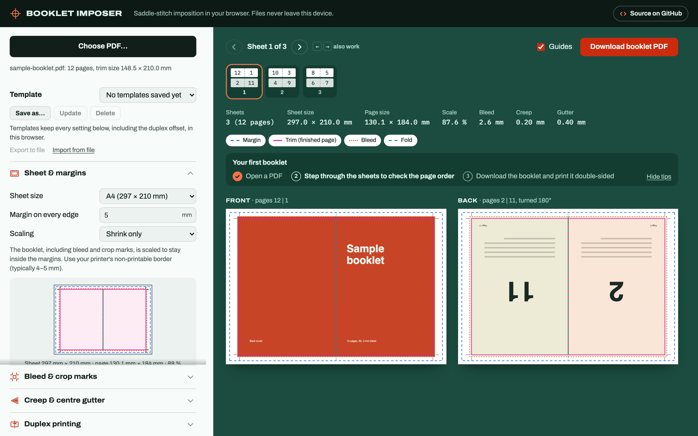
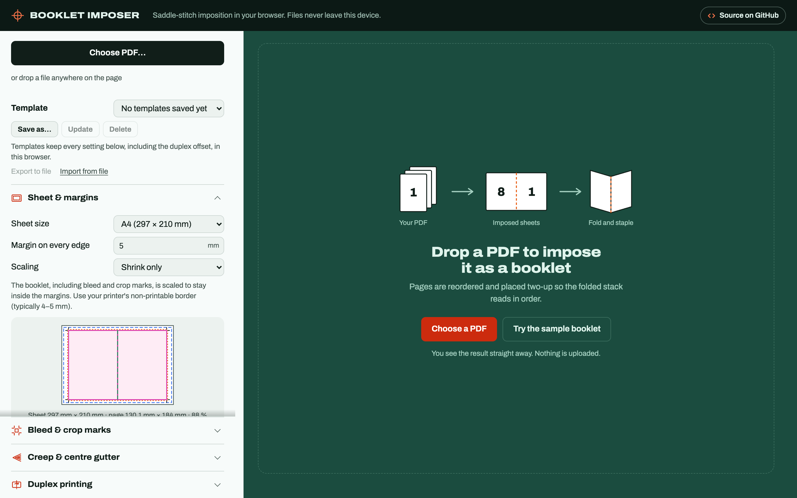
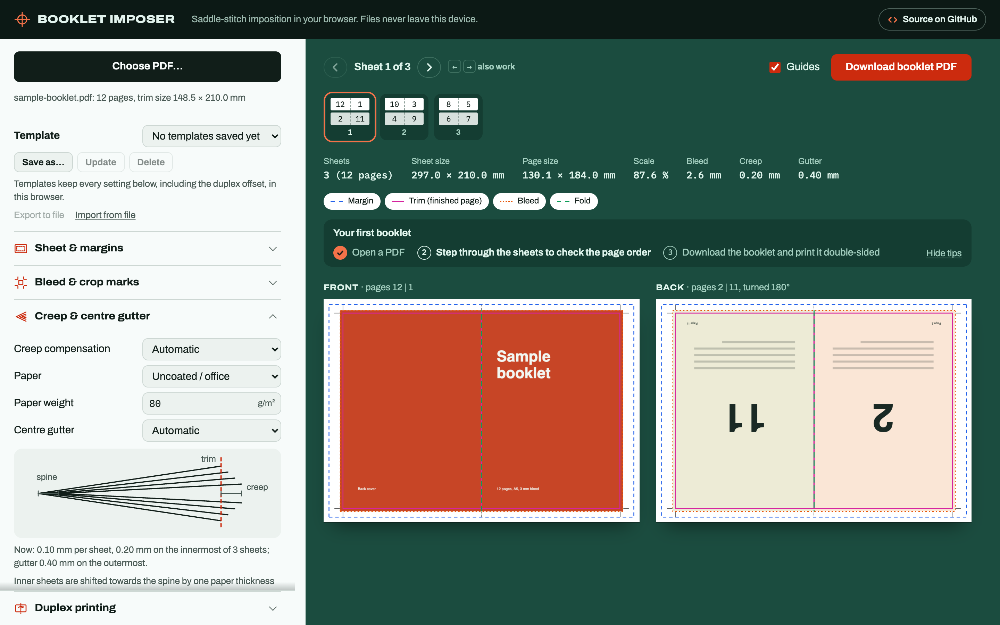
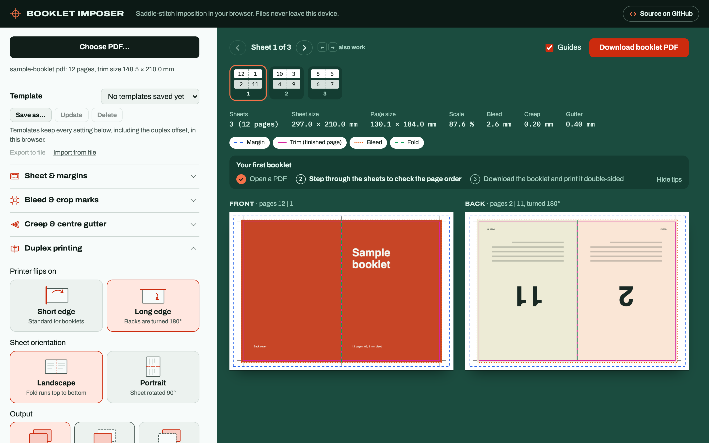

<div align="center">


# Booklet Imposer

**Turn any PDF into a print-ready saddle-stitch booklet, right in your browser.**<br>
Free, unlimited and self-hosted: no paywall, no quotas, no watermark, no sign-up.<br>
Your documents never leave your device.

[](https://github.com/pklaschka/pdf-booklet-imposer/actions/workflows/publish.yml)
[](https://github.com/pklaschka/pdf-booklet-imposer/pkgs/container/pdf-booklet-imposer)
[](#quick-start)
[](LICENSE)
[](#free-without-the-fine-print)

[Quick start](#quick-start) · [How it works](#how-it-works) · [Features](#features) · [Development](#development)

<br>

<picture>
  <source media="(prefers-color-scheme: dark)" srcset="docs/preview-dark.png">
  
</picture>

</div>

<br>

Export an A5 document page by page, and the tool lays it out two-up on A4 (or
any other sheet) in the order that reads correctly once the stack is printed
double-sided, folded and stapled. It also handles the details that usually
need prepress software: bleed, crop marks, creep, and duplex printers that do
not register front and back exactly.

## Free, without the fine print

Most online booklet makers are free only until you need them: a few PDFs
every few hours, a page or file-size cap, a watermark on the output, or an
account and a subscription for anything beyond a test run. This one has none
of that.

|                                    | Booklet Imposer                                                           |
| ---------------------------------- | ------------------------------------------------------------------------- |
| Price                              | ✅ Free, open source (EUPL-1.2)                                           |
| Booklets per hour, day or month    | ✅ Unlimited                                                              |
| Pages or file size                 | ✅ Unlimited (only your device's memory)                                  |
| Watermark on the output            | ✅ None                                                                   |
| Account or e-mail address          | ✅ Not needed                                                             |
| Features held back for a paid tier | ✅ None: creep, bleed, crop marks and duplex calibration are all included |
| Uploads                            | ✅ None, everything runs in your browser                                  |
| Hosting                            | ✅ Self-hosted on your own machine or server, no third-party service      |

There is no server-side processing to pay for, so there is nothing to ration.
You run it yourself [with one command](#quick-start): no vendor can add a
limit, change the pricing or shut it down, and it stays free for as long as
you host it.

<table>
  <tr>
    <td width="33%" valign="top">
      <h3>🔒 Private by design</h3>
      Everything runs in the browser. The server only delivers static files;
      no PDF is ever uploaded.
    </td>
    <td width="33%" valign="top">
      <h3>✂️ Print-shop details</h3>
      Bleed, crop and fold marks, and creep compensation, so the finished
      booklet trims cleanly.
    </td>
    <td width="33%" valign="top">
      <h3>🖨️ Made for office printers</h3>
      Long-edge duplexing, manual duplexing and a calibration sheet that
      corrects front/back misalignment.
    </td>
  </tr>
</table>

## Quick start

With the published image:

```sh
docker run -d -p 8080:8080 --read-only --tmpfs /tmp ghcr.io/pklaschka/pdf-booklet-imposer:latest
```

Then open <http://localhost:8080>.

Or build it yourself:

```sh
docker compose up -d --build     # http://localhost:8080
```

The image is nginx (unprivileged, port 8080) serving the built app, for
`linux/amd64` and `linux/arm64`. It uses relative URLs, so it also works
behind a reverse proxy under a sub-path. `/healthz` answers `ok` for health
checks. There is nothing to configure and no data to persist.

## How it works



1. **Open** a PDF by dropping it on the page, or try the built-in sample
   booklet.
2. **Check** the page order by stepping through the sheets. The coloured
   guides show margin, trim, bleed and fold.
3. **Print** the downloaded booklet double-sided at 100 %. A short print
   recipe with the right dialog settings appears after each download.
4. **Fold and staple.** Done.

<br clear="right">

## Features

- **Imposition**: pages are reordered two-up for folding; the page count is
  padded to a multiple of four (blanks at the end or before the back cover).
- **Margins and scaling**: a margin is kept free on every sheet edge and the
  booklet, including bleed and marks, is scaled down to fit. Scaling can also
  fill the sheet or be switched off, and the sheet can be sized automatically.
- **Bleed and crop marks**: bleed is entered manually (default 3 mm on every
  edge) or read from the PDF's TrimBox/BleedBox. Bleed is printed on the outer
  edges and into the gutter, never across the fold. Crop marks and fold marks
  are on by default.
- **Creep and centre gutter**: each sheet nested inside another is shifted
  towards the spine by one paper thickness, derived from paper weight and
  type or entered directly. The automatic gutter is twice the total creep, so
  the innermost pages meet exactly at the fold and no content is lost. Crop
  marks follow the shifted pages.
- **Office duplex**: back sides are turned 180° for printers that flip on the
  long edge (the default), sheets can be output in portrait, and fronts and
  backs can be exported separately for manual duplexing.
- **Duplex offset calibration**: print the calibration sheet double-sided,
  hold it against a light with the back facing you, read the two rulers and
  add the values to the X/Y offset. Back sides are shifted to compensate.
  Reprinting the sheet verifies the result (both lines on 0). The sheet lists
  the settings it was made with. The procedure has been verified in print.
- **Templates**: any set of settings, including the duplex offset, can be
  saved under a name, re-applied, updated and deleted. Templates live in the
  browser; export them to a JSON file to move them to another browser.

<table>
  <tr>
    <td></td>
    <td></td>
  </tr>
  <tr>
    <td align="center">Creep is derived from paper type and weight</td>
    <td align="center">Duplex options for office printers</td>
  </tr>
</table>

Settings and templates are kept in the browser's local storage. New versions
keep what you saved: changed defaults only apply to settings you never touched.

## Limits

> [!NOTE]
> These are deliberate scope limits, not bugs.

- One signature (saddle stitch). Very thick books need multiple signatures,
  which this tool does not produce.
- Left-to-right binding only.
- Password-protected PDFs must be unlocked first.
- Section animations and some layout details need a current browser; older
  ones fall back to plainer behaviour.

## Development

The project uses [Vite+](https://viteplus.dev) (`vp`) for the dev server,
formatting, linting, type checks, tests and the build.

```sh
vp install       # install dependencies
vp run dev       # dev server
vp check         # format, lint and type checks (vp check --fix to apply fixes)
vp test          # unit tests (layout maths, PDF output)
vp run test:e2e  # browser tests (Playwright) against a fresh build
vp run build     # production build to dist/
```

`vp run dev` and `vp run build` go through the package scripts, which first
copy the pdf.js runtime assets into `public/pdfjs`. Without the `vp` CLI
installed, `npm install` and `npm run dev|check|test|build` do the same.

<details>
<summary><b>Where things live</b></summary>

| Path                                  | Purpose                                                           |
| ------------------------------------- | ----------------------------------------------------------------- |
| `src/lib/settings.ts`                 | Settings type, defaults, paper sizes and paper bulk               |
| `src/lib/layout.ts`                   | Page order, scaling, creep and gutter (pure maths)                |
| `src/lib/source.ts`                   | Page boxes, bleed detection, page rotation                        |
| `src/lib/impose.ts`                   | Draws the sheets with pdf-lib                                     |
| `src/lib/geometry.ts`                 | Sheet transforms (rotation, duplex offset), free of PDF libraries |
| `src/lib/pdf-tools.ts`                | Everything that needs the PDF libraries, loaded on demand         |
| `src/lib/calibration.ts`              | Duplex calibration sheet                                          |
| `src/lib/persist.ts`                  | Saved settings: storage format and migration                      |
| `src/lib/sample.ts`                   | Built-in sample booklet                                           |
| `src/lib/preview.ts`                  | pdf.js preview                                                    |
| `src/main.ts`                         | App shell: state, settings form, preview, wiring                  |
| `src/ui/templates.ts`                 | Settings templates                                                |
| `src/ui/onboarding.ts`                | First-booklet tips and the bleed question                         |
| `src/ui/sections.ts`                  | Sidebar accordion with pinned headings                            |
| `src/ui/diagrams.ts`                  | Sidebar diagrams and the preview guide overlay                    |
| `src/ui/dropzone.ts`, `src/ui/dom.ts` | Drag and drop, small DOM helpers                                  |
| `src/style.css`                       | Styles; sizes and timings shared with script are CSS variables    |
| `e2e/`                                | Browser tests                                                     |

</details>

The browser tests live in `e2e/`. They need a browser once:
`npx playwright install chromium`, or set `E2E_CHANNEL=chrome` to use an
installed Chrome. Set `E2E_BASE_URL` to test something already running, for
example the Docker image on `http://localhost:8080/`.

### Continuous delivery

`.github/workflows/publish.yml` runs on every push to `main`:

1. It builds the image. The Docker build runs `vp check` and the unit tests.
2. It starts that image and runs the browser tests against it, so nginx, the
   security headers and the built files are tested as they will ship.
3. Only then does it push `ghcr.io/pklaschka/pdf-booklet-imposer:latest` and `:sha-<commit>` for
   amd64 and arm64.

It needs no secrets beyond the built-in `GITHUB_TOKEN`.

## Licence

Copyright © 2026 Zuri Nimca Klaschka. Licensed under the
[European Union Public Licence v. 1.2](LICENSE) (EUPL-1.2).

Bundled third-party components keep their own licences:
[pdf-lib](https://github.com/cantoo-scribe/pdf-lib) (MIT, the maintained `@cantoo/pdf-lib` fork),
[pdf.js](https://github.com/mozilla/pdf.js) (Apache-2.0), and the
[Archivo](https://github.com/Omnibus-Type/Archivo) and
[IBM Plex Mono](https://github.com/IBM/plex) typefaces (SIL OFL 1.1).
